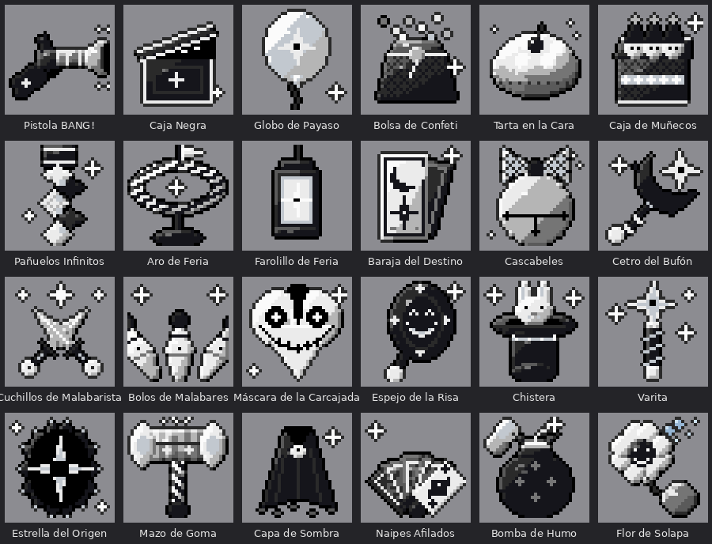

# 🃏 Jester's Tricks — Forge 1.20.1

Las armas, trucos y poderes del **Jester**: un bufón arlequín negro, gris y blanco, con máscara blanca y una flor negra en el sombrero. Es una criatura de otro mundo que lleva una eternidad en el de Minecraft: poderoso, pero también juguetón. Siniestro, pero con humor.

- Todo sale **solo de la pestaña "Jester's Tricks" del modo creativo**: no hay recetas ni botín.
- **Solo el Jester** puede usar los objetos. Los demás reciben un aviso y una risita.
- Texturas pixel art 32x32 con los colores de su skin. Varias armas son 3D en la mano.
- En español e inglés.

*English: a Forge 1.20.1 mod with clown and jester magic weapons, usable only by the player chosen as the Jester (`/jester add <player>`). The game text is translated into English.*

---

## 👑 Cómo hacer a alguien Jester

Hace falta ser **operador** (en un mundo de un jugador, tener los **trucos activados**).

```
/jester add NombreDelJugador
```

Se aplica al momento, sin reiniciar. El jugador tiene que estar **conectado**.

| Comando | Qué hace |
|---|---|
| `/jester add <jugador>` | Lo convierte en Jester (puede haber varios) |
| `/jester remove <jugador>` | Le quita el poder (aunque no esté conectado) |
| `/jester list` | Dice quién es Jester |
| `/jester clear` | Vacía la lista: **cualquiera** puede usar los objetos |

> ⚠️ Mientras la lista esté vacía, **todo el mundo** puede usar los objetos (sirve para probar el mod). En cuanto añades a un Jester, solo él puede.

**Cómo ser operador:**
- **Servidor:** en la consola del servidor escribe `op NombreDelJugador`.
- **Un jugador:** crea el mundo con *Permitir trucos* activado, o en un mundo ya creado pulsa *Esc → Abrir en LAN → Permitir trucos: Sí → Empezar*.

**A mano, sin comando:** arranca el mundo una vez con el mod, abre `saves/<mundo>/serverconfig/jestertricks-server.toml` (en un servidor, `world/serverconfig/...`), pon `jesterNames = ["NombreDelJugador"]` y reinicia. El nombre no distingue mayúsculas.

---

## Objetos



| Objeto | Qué hace |
|---|---|
| Cetro del Bufón | 16 de daño + Marchitamiento II. Clic derecho: tormenta de pétalos negros (náusea, ceguera, lentitud y daño a 7 bloques). |
| Naipes Afilados | Abanico de 3 naipes (10 de daño cada uno). Agachado: un as de 24 de daño. 3D en la mano. |
| Cuchillos de Malabarista | Cuchillo de 18 de daño que vuelve a tu mano como un bumerán. 3D en la mano. |
| Mazo de Goma | Poco daño, retroceso enorme y "¡boing!". Clic derecho: martillazo al suelo. 3D en la mano, 2D en el inventario. |
| Pistola BANG! | Dispara banderitas de payaso. Explotan: 4 corazones que atraviesan armadura y **nunca matan**, y aplican **Pranked!** 10 s. 3D en la mano. |
| Chistera | Saca un conejo, un objeto al azar (a veces muy bueno) o murciélagos. |
| Varita | Intercambia tu posición con una criatura. Agachado: teletransporte a donde miras. Abre mini portales en cada extremo del salto. |
| Bomba de Humo | Invisibilidad + Velocidad III, ciega a todo lo cercano y te pierden de vista. |
| Pañuelos Infinitos | Gancho: te lleva al bloque o atrae criaturas. Agáchate para soltarte. |
| Flor de Solapa | Chorro de agua: empuja, apaga fuego y destroza a Endermen y Blazes. |
| Caja Sorpresa (bloque) | Al pisarla o abrirla sale el Jester y te lanza por los aires. Se coloca mirando hacia ti. |
| Cojín de Pedorretas (bloque) | Quien lo pisa suelta una pedorreta y queda mareado. |

### Poderes de su mundo de origen

| Objeto | Qué hace |
|---|---|
| Estrella del Origen | Abre una grieta y te lleva a otra dimensión (posición equivalente, siempre en un sitio seguro). Agachado: eliges destino (mundo normal, Nether o End). |
| Aro de Feria | Agachado + clic en el suelo: aro **fijo** para siempre (si pones otro fijo, el anterior desaparece). Clic normal: aro temporal. Al saltar por un temporal, este desaparece y apareces en el fijo, aunque esté en otra dimensión. Los temporales sin usar se desvanecen a los 2 minutos. |
| Caja Negra | Clic: bolsillo de 27 huecos que viaja con la caja. Agachado sobre una criatura: se la traga (ni jefes). Agachado en el suelo: la suelta. **Agachado sobre un jugador: lo mete 1 minuto en la dimensión de bolsillo.** Agachado al aire: el Jester entra o sale de su bolsillo. |
| Baraja del Destino | Sobre otro jugador o criatura: carta mala al azar (Pranked!, levitar, brillar, lentitud, mareo, ceguera, ¡a bailar!, teletransporte...). Al aire: carta buena para ti (fuerza, velocidad, regeneración, resistencia...). |
| Espejo de la Risa | Salen tres copias del Jester con su skin. Los monstruos van a por ellas y estallan en confeti al golpearlas. |
| Cascabeles | Todo lo que hay a 10 bloques se pone a bailar, y los invisibles dejan de serlo y brillan. |
| Caja de Muñecos | Salen 3 muñecos arlequín (Jesters en miniatura) que le siguen a saltitos, atacan a quien le ataca o a quien él ataca, y estallan en confeti al caer. Agachado: vuelven a la caja. |

### La dimensión de bolsillo

Dentro de la Caja Negra hay un mundo: un suelo infinito de rombos arlequín bajo un cielo negro, donde el horizonte se pierde en la niebla.

- Quien es tragado ve, **en gigante**, todo lo que el Jester guarda en la Caja: los objetos del bolsillo como estatuas enormes y bien separadas (hasta 10 en un círculo cercano y el resto en otro más lejano), y la criatura tragada al fondo del todo. Nadie puede tocarlos, solo mirarlos mientras camina.
- Dentro **no se puede romper, poner, usar objetos ni pegar**, y nadie recibe daño.
- Se oyen risas lejanas y susurros, y flotan estrellas del origen.
- Sale solo al **minuto** (lleva una cuenta atrás), y vuelve justo a donde estaba.
- El Jester puede **entrar** (agachado + clic al aire con la Caja) y allí los demás lo ven **gigante**. Con un clic a un jugador lo **saca** antes de tiempo. Para salir, otra vez agachado + clic al aire.
- El Jester puede **construir** dentro con cualquier bloque: su casa se queda guardada para siempre. El suelo de rombos no se rompe y los atrapados siguen sin poder tocar nada.

### Trucos de feria

| Objeto | Qué hace |
|---|---|
| Bolos de Malabares | Lanza 3 bolos que rebotan de un enemigo a otro (cada bolo golpea hasta 3 veces). |
| Globo de Payaso | Sobre una criatura o jugador: le ata un globo que lo eleva 5 segundos; al explotar baja flotando. Al aire: te lo atas tú. |
| Tarta en la Cara | ¡SPLAT! Ciega, marea y ralentiza. Infinitas. |
| Cañón de Circo (bloque) | Clic derecho: el Jester sale disparado hacia donde mira y aterriza sin daño. |

**Decoración** (cualquiera puede colocarla): Bloque, Losa y Escaleras Arlequín, Lona de Carpa y su losa, Farolillo de Feria y Cartel de Feria.

### Poderes

Cada poder es un objeto: clic derecho para usarlo. No hay teclas. Tienen recarga.

| Objeto | Poder |
|---|---|
| Máscara de la Carcajada | **Carcajada**: los monstruos cercanos huyen y quedan debilitados. (30 s) |
| Bolsa de Confeti | **Lluvia de confeti**: ciega y frena un momento a todo lo que te rodea. (20 s) |
| Capa de Sombra | **Paso de sombra**: 3 segundos invisible, rápido y los golpes te atraviesan. (25 s) |

### Pasivas del Jester

Se encienden o apagan en su pantalla: el botón **✦** que aparece a la derecha del inventario (solo lo ve el Jester). El ajuste se guarda aunque mueras o reinicies.

- No recibe daño de caída (aterriza con confeti).
- Visión nocturna permanente.
- Cada vez que acaba con algo, se ríe y suelta confeti con estrellas.

Cada arma tiene su propio mensaje de muerte ("X se llevó una tarta en la cara de Y", "X hizo ¡BOING! por última vez"...).

**Pranked!**: mientras dura, la armadura pierde sus encantamientos (Protección y sus variantes, Caída de pluma y Espinas).

Los proyectiles (naipe, cuchillo, banderita y nudo de pañuelos) vuelan con modelos 3D.

---

## ⚙️ Configuración

Archivo `serverconfig/jestertricks-server.toml` dentro del mundo:

| Ajuste | Qué hace |
|---|---|
| `jesterNames` | Lista de jugadores Jester (lo mismo que `/jester add`) |
| `damageMultiplier` | Multiplica el daño de todo (1.0 normal, 0.5 la mitad, 2.0 el doble) |
| `cooldownMultiplier` | Multiplica las recargas (0.5 el doble de rápido, 2.0 el doble de lento) |

---

## 📥 Instalar

1. Instala **Minecraft Forge 1.20.1** (versión 47.x).
2. Descarga el mod: en este repositorio ve a **Actions**, abre la compilación más reciente con ✅ y baja **jestertricks-jar** (es un .zip con el .jar dentro).
3. Copia `jestertricks-1.20.1-1.0.0.jar` a la carpeta `mods`.
4. En un servidor, el mod tiene que estar **en el servidor y en todos los jugadores**.

> Cada versión nueva del jar sustituye a la anterior: no mezcles versiones entre servidor y jugadores.

## 🔨 Compilar tú mismo

1. Instala **JDK 17** (por ejemplo, Temurin 17).
2. En esta carpeta: `gradlew.bat build` (Windows) o `./gradlew build` (Mac/Linux).
3. El jar queda en `build/libs/`. Para probar sin instalar: `gradlew runClient`.

Cada vez que se sube un cambio a GitHub, **Actions** lo compila automáticamente.

## 🎨 Retocar

- Texturas: `src/main/resources/assets/jestertricks/textures/`
- Modelos 3D (se abren con Blockbench): `assets/jestertricks/models/item/*_3d.json`, sección `display` para cómo se sostienen.
- Textos: `assets/jestertricks/lang/es_es.json` y `en_us.json`
